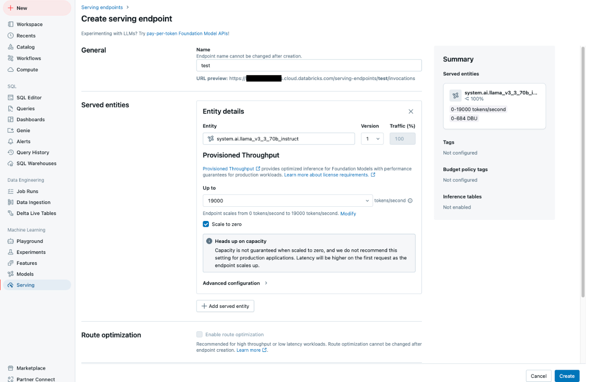

.. _deploy:

===============
LLM Deployments 
===============

Prototype Deployment
++++++++++++++++++++

Gradio vs. Streamlit
--------------------

Gradio and Streamlit are popular Python frameworks for building interactive web applications, 
particularly for data science and machine learning. 

- **Gradio**  
  - Designed primarily for AI/ML applications.  
  - Ideal for creating quick demos or prototypes for machine learning models.  
  - Focuses on simplicity in serving models with minimal setup.  
  - Works well for sharing ML models and allowing users to test them interactively.  

- **Streamlit**  
  - General-purpose framework for building data science dashboards and applications.  
  - Suitable for broader use cases, including data visualization, analytics, and ML demos.  
  - Offers more flexibility for building data-centric apps.

.. list-table:: Feature Comparison
   :header-rows: 1

   * - Feature
     - Gradio
     - Streamlit
   * - Pre-built components
     - Yes (optimized for ML models)
     - Yes (general-purpose widgets)
   * - Layout flexibility
     - Limited
     - Extensive
   * - Multi-page support
     - No
     - Yes
   * - Real-time updates
     - Limited
     - Supported with ``st.session_state``
   * - Python only?
     - Yes
     - Yes

Deployment with Gradio
----------------------

Ollama Local Model 
~~~~~~~~~~~~~~~~~~

.. code-block:: python 

    from langchain_ollama import ChatOllama

    llm = ChatOllama(model="mistral",temperature=0)

    from langchain_core.messages import AIMessage

    messages = [
        (
            "system",
            "You are a helpful assistant that translates English to French. Translate the user sentence.",
        ),
        ("human", "I love programming."),
    ]
    ai_msg = llm.invoke(messages)
    ai_msg

Gradio Chat Interface 
~~~~~~~~~~~~~~~~~~~~~

.. code-block:: python 

    system_message = "You are a helpful chat assistant who acts like a pirate."

    def stream_response(message, history):
        print(f"Input: {message}. History: {history}\n")

        history_langchain_format = []
        history_langchain_format.append(SystemMessage(content=system_message))

        for human, ai in history:
            history_langchain_format.append(HumanMessage(content=human))
            history_langchain_format.append(AIMessage(content=ai))

        print(f"History: {history_langchain_format}\n")

        if message is not None:
            history_langchain_format.append(HumanMessage(content=message))
            partial_message = ""
            for response in llm.stream(history_langchain_format):
                partial_message += response.content
                yield partial_message

    demo_interface = gr.ChatInterface(

        stream_response,
        textbox=gr.Textbox(placeholder="Send to the LLM...",
                        container=False,
                        autoscroll=True,
                        scale=7),
    )

    demo_interface.launch(share=True, debug=True)

Demo
~~~~

.. list-table::
   :width: 100%
   :class: borderless

   * - .. image:: images/ollama_gradio.png
        :width: 100%
            
     - .. image:: images/gradio.png
        :width: 100%

Production Deployment
+++++++++++++++++++++

.. _fig_endpoint_db:

    Serving Endpoint in Databricks